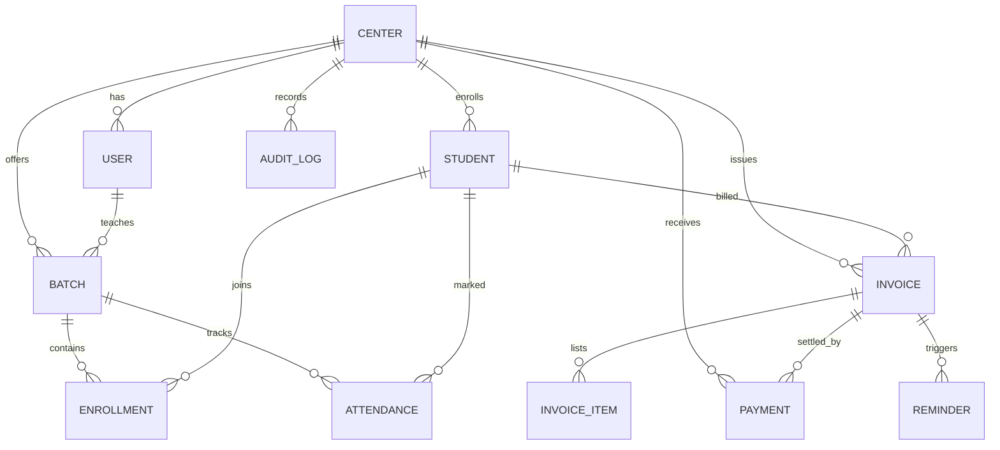

# 03. Database Design

**Database:** PostgreSQL (Supabase or Neon)
**ORM:** Prisma or Drizzle
**Tenancy model:** shared database, shared schema, `center_id` on every business table.

---

## 1. ER diagram

---

## 2. Tables

> Conventions: `id` is a UUID primary key. `created_at` / `updated_at` on every table. Money is `integer` paise. `deleted_at` is used for soft deletes where noted.

### center
| Column | Type | Notes |
|---|---|---|
| id | uuid PK | |
| name | text | |
| slug | text unique | for friendly URLs |
| phone, email | text | contact |
| logo_url | text null | |
| billing_day | int default 1 | day of month for invoice generation |
| grace_days | int default 7 | |
| timezone | text default `Asia/Kolkata` | |
| gateway_provider | text null | e.g. `razorpay` |
| gateway_key_id | text null | public key; secrets stored encrypted |
| plan | text default `pilot` | for FeeDesk's own billing, later |
| status | text | `active`, `suspended` |

### user
| Column | Type | Notes |
|---|---|---|
| id | uuid PK | matches auth provider's user ID if possible |
| center_id | uuid FK | |
| name, email, phone | text | email unique per auth provider |
| role | enum | `admin`, `staff` |
| status | enum | `invited`, `active`, `removed` |

### batch
| Column | Type | Notes |
|---|---|---|
| id | uuid PK | |
| center_id | uuid FK | |
| name | text | e.g. "Class 10 Maths, Morning" |
| subject | text null | |
| teacher_id | uuid FK → user null | |
| monthly_fee | int | paise |
| schedule | jsonb | days and times |
| status | enum | `active`, `archived` |

### student
| Column | Type | Notes |
|---|---|---|
| id | uuid PK | |
| center_id | uuid FK | |
| name | text | |
| parent_name | text | |
| parent_phone | text | |
| parent_email | text null | |
| fee_override | int null | paise; overrides batch fee |
| remind_enabled | bool default true | |
| status | enum | `active`, `archived` |
| joined_on | date | |

### enrollment
| Column | Type | Notes |
|---|---|---|
| id | uuid PK | |
| center_id | uuid FK | |
| student_id | uuid FK | |
| batch_id | uuid FK | |
| fee_override | int null | per-batch override |
| started_on / ended_on | date | |

*Unique: (student_id, batch_id) where ended_on is null.*

### invoice
| Column | Type | Notes |
|---|---|---|
| id | uuid PK | |
| center_id | uuid FK | |
| student_id | uuid FK | |
| number | text | unique per center, e.g. `ABC-2026-0001` |
| period_month | date | first day of the billed month |
| total_amount | int | paise |
| paid_amount | int default 0 | paise |
| due_date | date | |
| status | enum | `pending`, `partial`, `paid`, `overdue`, `cancelled`, `waived` |
| pay_token | text unique | long random token for the payment link |
| cancelled_reason | text null | |

*Unique: (center_id, student_id, period_month) to prevent duplicate monthly invoices.*

### invoice_item
| Column | Type | Notes |
|---|---|---|
| id | uuid PK | |
| invoice_id | uuid FK | |
| center_id | uuid FK | duplicated for tenant filtering |
| description | text | "Class 10 Maths, Oct 2026" |
| amount | int | paise (can be negative for discounts) |
| kind | enum | `fee`, `late_fee`, `discount`, `adjustment` |

### payment
| Column | Type | Notes |
|---|---|---|
| id | uuid PK | |
| center_id | uuid FK | |
| invoice_id | uuid FK | |
| amount | int | paise (negative for refunds) |
| method | enum | `online`, `cash`, `upi_direct`, `bank`, `other` |
| status | enum | `succeeded`, `failed`, `refunded` |
| gateway_order_id | text null | |
| gateway_payment_id | text null unique | **prevents double-recording** |
| paid_at | timestamptz | |
| recorded_by | uuid FK → user null | null for online |
| note | text null | |

### reminder
| Column | Type | Notes |
|---|---|---|
| id | uuid PK | |
| center_id | uuid FK | |
| invoice_id | uuid FK | |
| channel | enum | `email`, `whatsapp_manual`, `sms` |
| scheduled_for | timestamptz | |
| sent_at | timestamptz null | |
| status | enum | `scheduled`, `sent`, `skipped`, `failed` |
| error | text null | |

### attendance
| Column | Type | Notes |
|---|---|---|
| id | uuid PK | |
| center_id | uuid FK | |
| batch_id | uuid FK | |
| student_id | uuid FK | |
| date | date | |
| status | enum | `present`, `absent`, `late`, `excused` |
| marked_by | uuid FK → user | |

*Unique: (batch_id, student_id, date).*

### audit_log
| Column | Type | Notes |
|---|---|---|
| id | uuid PK | |
| center_id | uuid FK | |
| user_id | uuid FK null | |
| action | text | e.g. `payment.recorded`, `invoice.cancelled` |
| entity_type / entity_id | text / uuid | |
| metadata | jsonb | before/after values |
| created_at | timestamptz | |

### webhook_event (for idempotency)
| Column | Type | Notes |
|---|---|---|
| id | uuid PK | |
| provider | text | `razorpay` |
| event_id | text unique | provider's event ID |
| payload | jsonb | |
| processed_at | timestamptz null | |

---

## 3. Indexes (start with these)

- `student (center_id, status)`
- `invoice (center_id, status, due_date)`
- `invoice (pay_token)` unique
- `payment (center_id, paid_at)`
- `attendance (batch_id, date)`
- `reminder (status, scheduled_for)`

---

## 4. Tenant isolation strategy

1. **Application layer:** every query goes through a helper that injects `center_id` from the session. Never query without it.
2. **Database layer (recommended):** enable **Row Level Security (RLS)** in Postgres/Supabase with policies like `center_id = auth.jwt() ->> 'center_id'`. If application code forgets a filter, the database still blocks the leak.
3. **Tests:** write automated tests that log in as Center A and try to read, update, and delete Center B's records. These must fail.
4. **Parent links:** public payment pages look up by `pay_token` and return only that invoice's minimal data.

---

## 5. Data handling notes

- Student records involve **minors' personal data**. Store only what's needed (name, parent contact, batch, fee info).
- Encrypt gateway secrets; never expose them to the browser.
- Plan a way to **export and delete** a center's data on request.
- Take regular backups; free database tiers often don't include automatic ones.
